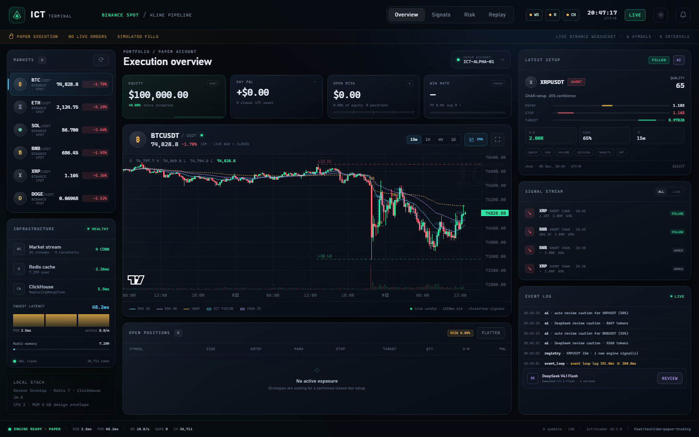

# ICT Trader

A reproducible ICT/SMC research engine and one frozen multi-timeframe setup.

The project is deliberately **not** a "buy/sell signal" package. It is a small,
auditable pipeline:

```text
OHLCV
  → key levels / liquidity pools
  → sweep + reclaim
  → FVG / IFVG / order block
  → CISD
  → displacement + quality score
  → 1D / 4H alignment
  → event-driven execution
  → MAE/MFE journal
  → purged walk-forward
```

## Why this exists

Most ICT scripts draw boxes and arrows. This one is built around four rules:

1. **Closed-candle decisions** — a signal exists only after the confirmation bar closes.
2. **No future levels** — a swing/session/key level cannot be used before `known_at`.
3. **Executable test** — next-bar entry, stop/target, costs, A-share T+1, stamp duty.
4. **Auditable output** — every trade keeps its checks, quality score, MAE and MFE.

## Realtime paper terminal

This branch adds a local, Docker-backed realtime paper-trading stack around the
same frozen setup: live Binance combined-stream WS ingestion, Redis hot cache,
ClickHouse closed-bar storage, gap detection + REST backfill, a SQLite WAL retry
queue, a closed-bar strategy adapter, a deterministic paper broker and a
self-contained Lightweight Charts dashboard with ICT/Chan overlays.

```powershell
# Redis + ClickHouse (memory-capped, local-only ports)
pwsh -File scripts/dev_up.ps1 -Install

# Production: real Binance WS/REST, paper execution only
.\.venv\Scripts\python.exe -m ict_trader.realtime

# http://127.0.0.1:8080
.\.venv\Scripts\python.exe scripts/smoke_realtime.py
```



PAPER ONLY — no exchange keys and no order routing. DeepSeek V4.1 Flash
(`deepseek-flash`) is available as a manual and auto-review risk layer
(server-side key, no execution authority). See
[`docs/REALTIME.md`](docs/REALTIME.md) for architecture, data contracts, gap
semantics, resource limits and acceptance checks.

Signals are traceable to their source closed bar: click a signal in the
dashboard or open `/?signal=<signal_id>` to load the K-line context, entry/SL/TP
and the exact signal marker. `/api/signals/{id}/context` returns
`aligned=true/false` plus the source bar.

The terminal has persisted dark/light themes (`?theme=light` for a preview).
The chart's last candle, watchlist and header price all use the same live bar:
it is merged from the 1 Hz WebSocket snapshot and can also be fetched with
`/api/klines?include_live=true`. Historical bars are refreshed only every 60
seconds, so live price updates do not depend on a polling chart request.

Project-level agent instructions and the phased backlog live in
[`docs/PROJECT_PROMPT.md`](docs/PROJECT_PROMPT.md) and
[`docs/EXECUTION_PLAN.md`](docs/EXECUTION_PLAN.md).

## Install

```bash
git clone https://github.com/beatyman/ICT-Trader.git
cd ICT-Trader
python -m venv .venv
# Windows
.venv\Scripts\activate
# Reproducible path: pinned runtime + test deps, then the project itself.
pip install -r requirements.lock
pip install --no-deps -e .
```

Optional Futu OpenD:

```bash
pip install -e ".[futu]"
```

## Quick start

CSV columns:

```text
date,open,high,low,close,volume
```

Analyze:

```bash
ict-trader analyze \
  --csv examples/ohlcv.csv \
  --symbol BTCUSDT \
  --bars 260 \
  --out output/chart.png \
  --signals output/signals.csv \
  --json-out output/analysis.json
```

Latest trade card:

```bash
ict-trader plan \
  --csv examples/15m.csv \
  --daily-csv examples/daily.csv \
  --market cn \
  --json-out output/trade_plan.json
```

Backtest:

```bash
ict-trader backtest \
  --csv examples/15m.csv \
  --daily-csv examples/daily.csv \
  --market cn \
  --t-plus-1 \
  --breakeven-at-r 1.5 \
  --out output/trades.csv \
  --metrics output/metrics.json
```

Purged walk-forward:

```bash
ict-trader walk-forward \
  --trades output/trades.csv \
  --folds 5 \
  --embargo-days 5
```

Execution journal:

```bash
ict-trader journal \
  --trades output/trades.csv \
  --out output/journal.csv \
  --summary output/journal_summary.json
```

Python:

```python
from ict_trader import ICTConfig, analyze, load_csv

df = load_csv("examples/ohlcv.csv")
result = analyze(df, ICTConfig(mode="historical"))
print(len(result.key_levels), len(result.sweeps), len(result.cisds))
```

## The frozen setup

The package ships one setup, not a parameter buffet:

```text
1D : Ichimoku cloud + Tenkan/Kijun + MACD     (3/3)
4H : Ichimoku cloud + Tenkan/Kijun + MACD     (>= 2/3)
15m: CISD long
     + a sweep in the last 15 bars
     + FVG/IFVG/OB PDA
     + displacement quality
     + weighted score
```

Entry: next 15m open by default; `--entry-mode retest_key` waits for a retest of the CISD level; `--entry-mode fvg_ce` waits for the FVG 50% CE.
Stop: CISD invalidation wick.
Target: fixed 2R by default; `--target-mode liquidity|hybrid` uses the nearest unswept opposing pool.
Risk: fixed fractional, one position per symbol, optional max concurrency.

Sweep/reclaim is multi-bar by default (`--sweep-reclaim-bars 3`): a level is not
marked broken until the reclaim window expires. The plan card also rejects a setup
whose entry is already more than `--max-entry-distance-atr` (default 0.5) away.

Every filter is explicit and can be disabled to run an ablation:

```text
--allow-no-sweep
--sweep-reclaim-bars
--entry-mode next_open|retest_key|fvg_ce
--target-mode fixed|liquidity|hybrid
--trail-activate-r / --trail-atr-mult
--max-daily-loss-r
--session-gate none|auto|london|ny_am|ny_pm|silver_bullet|cn|hk
--pd-gate
--ote-gate
--require-pda-array
--require-first-fvg
--require-fresh-fvg
--max-inducements
--quality-profile standard|high_value|high_rr|btc_15m   (btc_15m has no proven edge,
                                                        see docs/BTC_15M_OPTIMIZATION.md)
--allow-short                       (bearish CISD setups; long-only by default)
--min-sweep-strength / --min-stop-atr
--fvg-min-width-atr                 (drop FVGs narrower than N ATR)
--t1-at-r / --t1-fraction / --t1-no-be   (partial scale-out; RR of the trade
                                   becomes the size-weighted blend of both legs)
--commission-bps                   charged once per ROUND TRIP: pass 2x the
                                   per-side rate (5bps/side -> 10)
--stack 1d_4h_15m|1d_1h_15m|1d_15m|4h_15m|4h_1h_15m
--origin-mode strict_sweep|pine
--origin-filter any|both|sweep|fvg
--ote-gate --ote-min --ote-max
--regime-trend-gate none|up|down|aligned
--regime-vol-gate none|low|normal|high
--min-setup-score
--min-disp-body / --min-disp-atr / --min-disp-multiple
--fvg-min-atr / --fvg-min-body
```

The measured A/B results and their limitations are in
[`docs/OPTIMIZATION.md`](docs/OPTIMIZATION.md). They are diagnostics, not a
profitability claim. The ten reference repositories and the ideas accepted/rejected
from each are reviewed in [`docs/REFERENCE_REVIEW.md`](docs/REFERENCE_REVIEW.md).

`--quality-profile high_value` is an **experimental** preset: it requires grade ≥4,
confluence ≥3, body/range ≥0.65 and a 2R target from the actual fill. It improved the
in-sample basket to 50% win rate / +0.03R over 30 trades, but failed the chronological
hold-out and is below the 100-trade gate. It is not the default.

The LuxAlgo Pine indicator is a detector, not a strategy. The concept mapping and the
limits of a Pine-to-Python backtest are documented in
[`docs/PINE_PARITY.md`](docs/PINE_PARITY.md).

Dataset duplication and full-vs-slice caveats are recorded in
[`docs/DATA_NOTES.md`](docs/DATA_NOTES.md).

The best current research candidate (not a validated live edge) is documented in
[`docs/BEST_SETUP.md`](docs/BEST_SETUP.md).

The enforceable ICT sequence and the DOL/kill-zone caveats are in
[`docs/ICT_CHECKLIST.md`](docs/ICT_CHECKLIST.md).

## Package layout

```text
src/ict_trader/
  concepts.py     key levels, FVG, IFVG, OB, structure, chart
  cisd.py         Pine-style CISD state machine
  sweeps.py       key levels + sweep/reclaim events
  context.py      optional session / premium-discount / OTE gates
  pd_arrays.py    breaker / mitigation / rejection arrays
  journal.py      planned-vs-actual execution journal
  enhancements.py HTF CISD, SMT, session levels
  indicators.py   Ichimoku, MACD, HTF resampling
  quality.py      displacement + weighted score
  setup.py        frozen multi-timeframe setup
  strategy.py     execution, risk, MAE/MFE, metrics
  walk_forward.py purged out-of-sample folds
  cli.py          `ict-trader`
```

## Output: trade card

`ict-trader plan` returns:

```json
{
  "decision": "TRADE",
  "setup": {
    "direction": "bull",
    "level": 71.21,
    "stop": 70.6,
    "target": 76.0,
    "grade": 4,
    "quality": 0.71,
    "checks": {
      "sweep": true,
      "pda": true,
      "volume": true
    }
  }
}
```

If the 1D/4H/sweep/quality gates are not met, it returns:

```json
{"decision": "NO_TRADE"}
```

This is a feature. Most days should be `NO_TRADE`.

## AI skill

The repository ships an agent skill at:

```text
skills/ict-analysis/SKILL.md
```

The skill requires the model to call the engine and read its JSON. It is not
allowed to invent levels or reverse-engineer a signal from a screenshot.

See:

- `skills/ict-analysis/SKILL.md`
- `skills/ict-analysis/references/ict_playbook.md`
- `skills/ict-analysis/schemas/trade_plan.schema.json`

## Quality gates

Before a strategy change is accepted:

```text
1. Unit tests pass.
2. No future data: levels carry known_at.
3. Entry is next bar, never the signal bar.
4. A-share test uses T+1 and stamp duty.
5. MAE/MFE are recorded.
6. Walk-forward has at least 3 positive and inspectable folds.
7. Sample >= 50 trades before changing thresholds.
```

## What this is not

- Not financial advice.
- Not a guaranteed profitable system.
- Not a replacement for point-in-time data.
- Not a full execution simulator (limit-up/down, suspension, borrow fees are
  still on the roadmap).

## License

MIT. See `LICENSE`.
