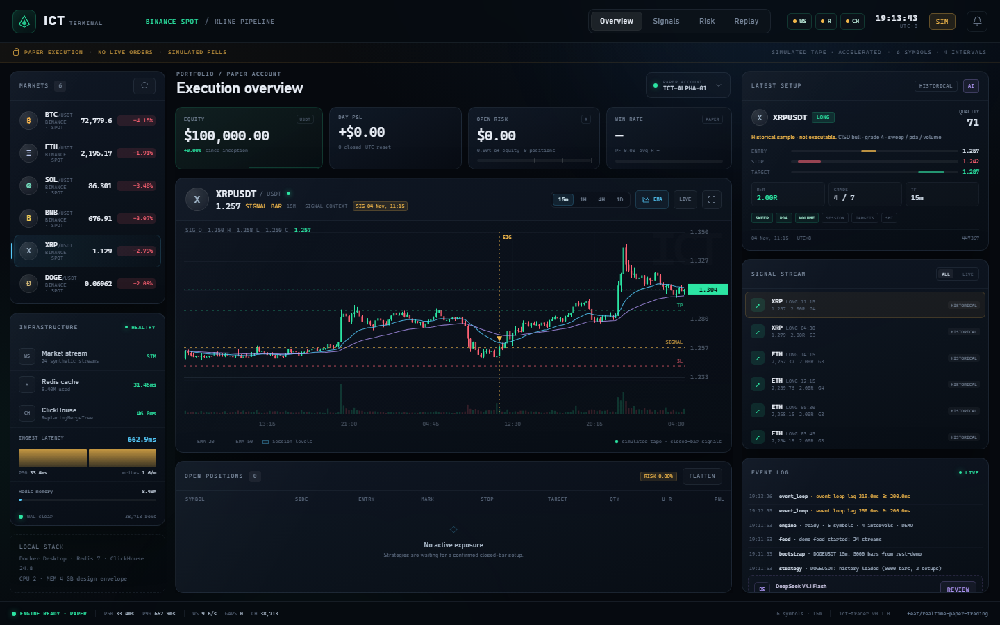
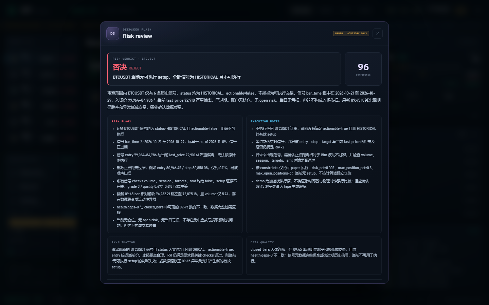

# Realtime paper-trading stack

This feature branch (`feat/realtime-paper-trading`) turns the research engine
into a runnable **local realtime terminal**:

```
Binance WS / accelerated demo tape
        │  combined streams, grouped by interval
        ▼
per-stream queue → gap state machine → REST backfill / replay
        │
        ├── Redis: latest hash + closed ZSet + closed hash (pipeline)
        ├── ClickHouse: append-only ReplacingMergeTree closed bars
        └── ICT setup on CLOSED bars → paper broker → dashboard
```

It is **paper-only by design**. There is no exchange order API key, no order
routing, and no claim that the frozen setup is profitable. The engine refuses
to start if `PAPER_TRADE=false`. An optional server-side DeepSeek V4.1 Flash
key is used only for on-demand risk review.


## 1. Local quickstart (Docker Desktop)

```powershell
# 1. Redis 7 + ClickHouse 24.8, memory-capped and tuned
pwsh -File scripts/dev_up.ps1 -Install

# 2. Accelerated demo tape (deterministic, offline after first seed)
.\.venv\Scripts\python.exe -m ict_trader.realtime --mode demo

# 3. Open the terminal
start http://127.0.0.1:8080
```

Live Binance market data instead of the demo tape:

```powershell
.\.venv\Scripts\python.exe -m ict_trader.realtime --mode live
```

The default live endpoint is `data-api.binance.vision` / 
`data-stream.binance.vision` (public market data, no key). Set
`BINANCE_WS_URL` and `BINANCE_REST_URL` to use the primary or USD-M futures
endpoints. For futures:

```powershell
$env:BINANCE_MARKET="futures"
.\.venv\Scripts\python.exe -m ict_trader.realtime --mode live
```

### Why demo mode exists

`--mode demo` fetches a real historical snapshot when the network allows,
falls back to deterministic synthetic bars, then emits accelerated live bars
(every `DEMO_SPEED` seconds per logical interval) with unclosed sub-ticks. It is
for validating the pipeline and UI offline, not for performance claims. The
dashboard carries a permanent `SIM` badge.

### Docker resource envelope

| Service | Limit | Notes |
|---|---:|---|
| `ict-redis` | 512 MB (`maxmemory 384mb`, `noeviction`) | cache/index only, persistence off |
| `ict-clickhouse` | 2 GB (`max_server_memory_usage 1.5GB`) | `max_threads=2`, merge pool 4, 128 MB mark cache |
| Python app | ~1 GB (compose app profile) | all analysis off the event loop |

The default `docker compose up -d` starts only Redis + ClickHouse. To run the
app in Docker too:

```powershell
docker compose --profile app up -d --build
```

Ports 6379/8123/9000 are bound to `127.0.0.1`; do not expose them publicly.

## 2. Code map

```
src/ict_trader/realtime/
  config.py              env config, stream grouping, public (secret-free) view
  models.py              Kline / UTC-ms contracts, Binance + CH + Redis mapping
  feed.py                combined-stream WS client, interval grouping, reconnect
  gap_detector.py        pure per-stream closed-bar state machine
  rest_backfill.py       rate/weight-limited REST filler, 429/418 handling
  demo.py                deterministic offline tape + accelerated feed
  engine.py              per-stream workers, pause/backfill/replay, orchestration
  storage/redis_store.py latest hash, closed ZSet/hash, pipeline + TTLs
  storage/clickhouse_store.py  DDL, batched writer, WAL retry, trade/signal tables
  storage/wal.py         SQLite append-only retry queue + dead letters
  strategy_runner.py     analyze()/build_setup() adapter on closed bars
  broker.py              fixed-fractional paper broker, stops/targets/time stop
  metrics.py             counters, P50/P99 latency rings, bounded event log
  api.py                 FastAPI JSON + WebSocket dashboard, paper flatten
  static/                dependency-free HTML/CSS/Canvas trading terminal
```

## 3. Data contracts

### Redis (hot cache, not system of record)

| Key | Type | Purpose |
|---|---|---|
| `kline:latest:{symbol}:{interval}` | Hash | newest bar, including `is_closed` |
| `kline:closed:zset:{symbol}:{interval}` | ZSet | recent closed open_times, score=open_time |
| `kline:closed:hash:{symbol}:{interval}:{open_time}` | Hash | immutable closed detail |
| `kline:price:{symbol}` | String, TTL 5m | last traded price for UI |

Every closed write is one pipeline: latest hash + detail hash + ZSet + ZREMRANGEBYRANK
+ TTLs. `maxmemory-policy noeviction` is intentional; evicting a latest hash
would silently corrupt consumer state. Redis has no RDB/AOF. After a restart the
unclosed bar is re-fetched (REST) or regenerated (demo), while all closed bars
are in ClickHouse.

### ClickHouse (system of record)

```sql
ENGINE = ReplacingMergeTree(ingest_time)
PARTITION BY toYYYYMM(open_time)
ORDER BY (symbol, interval, open_time)
```

Fields: `symbol, interval, open_time, close_time, open, high, low, close,
volume, quote_volume, trades, taker_buy_base, taker_buy_quote, ingest_time`.
DDL is created idempotently at startup (`ict.klines`, `ict.paper_trades`,
`ict.signals`). TTL defaults to 365 days.

The synchronous `clickhouse-connect` client is only called inside
`asyncio.to_thread`; every call shares a lock because a client session is not
safe for concurrent queries. Inserts are batched (`CH_BATCH_SIZE=500` or
`CH_FLUSH_SECONDS=2`). A failed batch is appended to the SQLite WAL and retried
with exponential backoff. `paper_trades` and `signals` are persisted separately.

## 4. Gap semantics (exact)

* Only `is_closed=True` advances `last_closed_open_time`.
* `open_time <= last_closed` → duplicate/out-of-order, dropped.
* `open_time == last_closed + interval` → accept.
* `open_time > expected` → **pause this stream only**, keep later messages in
  its queue, REST-fetch `[expected, open_time - interval]`, process recovered
  bars as `recovered=True` (stored, but never traded), then process the paused
  bar and resume.
* Backfill is rate-limited (4 req/s default) and retries with jittered
  exponential backoff. 429 honours `Retry-After`; 418 backs off hard.
* If the retry budget is exhausted, the stream stays paused and retries every
  `BACKFILL_OUTER_RETRY_SECONDS` (60s). A dead letter is recorded; the stream
  cannot silently skip the gap. This is why a stalled consumer is visible in
  the UI/session queue rather than losing bars.

A per-stream queue means a BTC 15m backfill cannot stall ETH 1m. The event loop
only parses and enqueues; storage and strategy work happen in workers/threads.

## 5. Strategy and execution

The adapter reuses the frozen research pipeline unchanged:

```python
analyze(df_15m, ICTConfig(...))
build_setup(df_15m, result, SetupConfig(market="crypto", stack=...))
```

* A setup is actionable only if its confirmation bar is the bar that just
  closed (`c.end == len(frame)-1`). No intrabar signal, no look-ahead.
* CPU work runs in a thread and is serialised by a semaphore. Each close uses a
  bounded evaluation window (1800 bars for 4H stacks, 8000 for 1D stacks) to
  keep worst-case latency predictable; the full 5000-bar history is still used
  once at bootstrap to populate the historical signal stream.
* `ICT_STACK=4h_15m` is the default because it is testable with a 5000-bar
  bootstrap. For `1d_4h_15m`, set `BOOTSTRAP_BARS=8000` (or more) so the 1D
  cloud (`52+26` daily bars) exists.
* Entry is the first mark after the close (next-open semantics at tick
  resolution). Stop is the CISD invalidation wick; target is the frozen setup
  target or a fixed `RR`.
* Fixed-fractional sizing: default 0.5% equity risk, 30% max notional per
  position, 95% gross cap, max 5 concurrent, one position per symbol.
* The paper broker charges 10 bps round-trip commission + 2 bps slippage per
  fill. If a closed bar contains both stop and target, **stop is always assumed
  first** (unknown intrabar path). Time stop is 40 strategy bars.
* Hard safety: `PAPER_TRADE` must remain true. The dashboard has a manual
  flatten button for paper positions only.

## 6. Dashboard

`http://127.0.0.1:8080` (FastAPI + vanilla Canvas, no Node build):

* 24h watchlist with sparklines and 15m / 1H / 4H / 1D chart tabs;
* candlesticks, EMA20/50, volume, active entry/stop/target levels, crosshair;
* equity / day P&L / open risk / win-rate cards;
* latest ICT setup card with grade, quality, RR and check chips;
* signal stream (including `HISTORICAL` setups discovered at bootstrap);
* open positions, paper blotter, event log and infrastructure health;
* WebSocket snapshot at 1 Hz, `/api/snapshot`, `/api/klines`,
  `/api/health`, `/api/docs`.

### Signal ↔ K-line alignment

Every paper signal carries `source_kline_open_time` (also exposed as
`bar_time`), and its entry is the **close of that exact bar**. The alignment is
checked by the API, not inferred by the UI:

```text
GET /api/signals/{signal_id}/context
→ signal, signal_bar, bars_before, bars_after, aligned=true/false, bars[]
```

`/api/klines` also accepts `end_time` so the dashboard can load the window
around a historical signal. Clicking a signal opens its source window, marks
the exact bar with a vertical `SIG` line, and draws the signal's entry/SL/TP.
A shareable URL is available:

```text
http://127.0.0.1:8080/?signal=<signal_id>
```



The alignment test (`tests/test_realtime_runner_adapter.py`,
`tests/test_realtime_ict_adapter.py`, `tests/test_realtime_api.py`) asserts:

- `source_kline_open_time` equals the source bar `open_time`;
- `entry` equals that bar's close;
- the context endpoint returns `aligned=true`;
- stale signals outside the retained chart window are not shown as markers.

### DeepSeek V4.1 Flash risk review



`DEEPSEEK_API_KEY` lives in `.env` (git-ignored) and is **never sent to the
browser**. To enable it:

```powershell
Copy-Item .env.example .env
# edit .env:
# DEEPSEEK_API_KEY=sk-...
# DEEPSEEK_MODEL=deepseek-flash   # API id for DeepSeek-V4.1-Flash
```

The model is called only when the operator presses `AI`/`REVIEW`; it receives a
compact snapshot (last 50 closed bars, selected-symbol signals, positions,
account, gap/latency health) and returns structured JSON.

* model: API id `deepseek-flash` (DeepSeek-V4.1-Flash), `reasoning_effort=low`,
  JSON-object response;
* role: risk reviewer only — it cannot open, close or modify a paper position;
* it is told to reject `HISTORICAL`/`actionable=false` setups and never invent
  prices;
* review latency observed locally: ~10–16s; ~6–8k prompt tokens per review;
* `POST /api/ai/review {"symbol":"BTCUSDT"}` and `GET /api/ai/status` are the
  API surface. The UI stores the last review for `/#ai` deep links.

If no key is set, the button is disabled and the deterministic system runs
exactly as before. The AI layer has no path into the execution broker.

## 7. Acceptance / validation

Unit tests:

```powershell
.\.venv\Scripts\python.exe -m pytest tests/test_realtime_*.py -q
```

Live smoke test (with the terminal running):

```powershell
.\.venv\Scripts\python.exe scripts/smoke_realtime.py
```

The smoke test asserts: engine ready, Redis/ClickHouse healthy, paper mode,
watchlist and strategy attached, ordered closed bars readable, and prints the
gap count / ClickHouse row count / equity.

Useful SQL:

```sql
SELECT count(), uniqExact(symbol, interval) FROM ict.klines;
SELECT symbol, interval, count(), max(open_time)
FROM ict.klines FINAL GROUP BY symbol, interval ORDER BY symbol, interval;
SELECT * FROM ict.signals ORDER BY created_at DESC LIMIT 10;
SELECT * FROM ict.paper_trades ORDER BY exit_time DESC LIMIT 10;
```

The acceptance example from the brief (50 symbols × 3 intervals, P99
parse→Redis <5 ms) is a target for a production VPS, not a local Docker
guarantee. The local stack exposes the right counters to measure it:
`metrics.latency.pipeline_ms`, `redis_ms`, `strategy_eval_ms`,
`clickhouse_batch_ms`, WAL pending, gap counts, per-session queue depth.

## 8. Operating notes and limits

* **Clock**: all internal timestamps are UTC ms; display is UTC+8. The VPS
  should run `chrony`; the Docker host still needs a correct clock.
* **Redis persistence**: off. If you require unclosed state across restart, turn
  on AOF and accept fsync latency; closed bars do not need it.
* **Strategy scale**: the adapter is compute-bound by the research engine
  (~1 s per 1800-bar symbol on this box). At 50 symbols, evaluations are
  serialised; 15m closes can be processed within minutes, but this is not HFT.
  For a production low-latency path, split strategy evaluation into a process
  pool and incrementally cache indicators.
* **Network**: Binance public market data can be geo-restricted. Use your own
  endpoint/proxy via env vars and respect local law/venue terms.
* **No look-ahead**: backfilled historical bars are stored but never traded.
* **Not financial advice.** Paper PnL is simulated and does not include borrow,
  funding, queue position or market impact.

## 9. Migration to the AWS Tokyo VPS

The compose limits map one-to-one to the t4g.medium brief: Redis 512 MB,
ClickHouse 2 GB / 2 query threads, Python ~1 GB, 50 GB gp3. On the VPS:

1. `docker compose up -d` (middleware).
2. Put the app behind a private network; expose only the dashboard through a
   reverse proxy with auth/TLS.
3. Run `chrony`, monitor offset, and pin `TZ=UTC`.
4. Use systemd or a process supervisor instead of a terminal.
5. Set `BINANCE_WS_URL`/`BINANCE_REST_URL` to the nearest endpoint and verify
   clock skew before trusting latency metrics.
