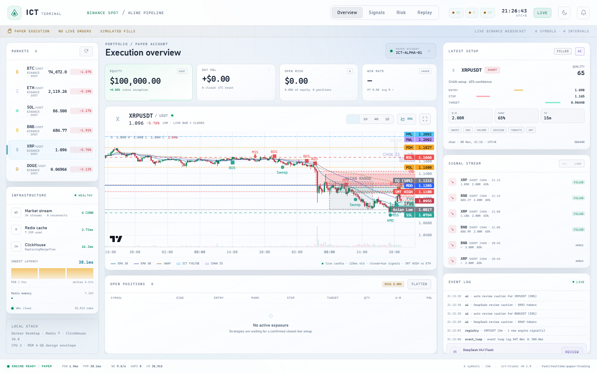

# Realtime paper-trading stack

This feature branch (`feat/realtime-paper-trading`) turns the research engine
into a runnable **local realtime terminal**:

```
Binance WS (production) / explicit local demo
        │  combined streams, grouped by interval
        ▼
per-stream queue → gap state machine → REST backfill / replay
        │
        ├── Redis: latest hash + closed ZSet + closed hash (pipeline)
        ├── ClickHouse: append-only ReplacingMergeTree closed bars
        └── ICT setup on CLOSED bars → paper broker → dashboard
```

It is **paper-only by design**. There is no exchange order API key, no order
routing, and no claim that the frozen setup is profitable. The engine refuses
to start if `PAPER_TRADE=false`. An optional server-side DeepSeek V4.1 Flash
key is used for on-demand review and for async auto-review of new high-confidence setups.


## 1. Local quickstart (Docker Desktop)

```powershell
# 1. Redis 7 + ClickHouse 24.8, memory-capped and tuned
pwsh -File scripts/dev_up.ps1 -Install

# 2. Production: live Binance market data, paper execution
.\.venv\Scripts\python.exe -m ict_trader.realtime

# 3. Open the terminal
start http://127.0.0.1:8080
```

`REALTIME_MODE=live` is the default. The same command is the production path:

```powershell
.\.venv\Scripts\python.exe -m ict_trader.realtime
```

Demo is explicit local-only and must never be used for production:

```powershell
.\.venv\Scripts\python.exe -m ict_trader.realtime --mode demo
```

The default live endpoint is `data-api.binance.vision` / 
`data-stream.binance.vision` (public market data, no key). Set
`BINANCE_WS_URL` and `BINANCE_REST_URL` to use the primary or USD-M futures
endpoints. For futures:

```powershell
$env:BINANCE_MARKET="futures"
.\.venv\Scripts\python.exe -m ict_trader.realtime --mode live
```

### Why demo mode exists

`--mode demo` fetches a real historical snapshot when the network allows,
falls back to deterministic synthetic bars, then emits accelerated live bars
(every `DEMO_SPEED` seconds per logical interval) with unclosed sub-ticks. It is
for validating the pipeline and UI offline, not for performance claims. The
dashboard carries a permanent `SIM` badge.

### Docker resource envelope

| Service | Limit | Notes |
|---|---:|---|
| `ict-redis` | 512 MB (`maxmemory 384mb`, `noeviction`) | cache/index only, persistence off |
| `ict-clickhouse` | 2 GB (`max_server_memory_usage 1.5GB`) | `max_threads=2`, merge pool 4, 128 MB mark cache |
| Python app | ~1 GB (compose app profile) | all analysis off the event loop |

The default `docker compose up -d` starts only Redis + ClickHouse. To run the
app in Docker too:

```powershell
docker compose --profile app up -d --build
```

Ports 6379/8123/9000 are bound to `127.0.0.1`; do not expose them publicly.

## 1.1 Production mode and data provenance

Production startup requires:

```dotenv
REALTIME_MODE=live
PAPER_TRADE=true
```

`live` means **real Binance market data**, not real order routing. The broker
remains paper-only by design (`PAPER_TRADE=true`; live routing is rejected at
configuration load).

Every K-line stored in Redis/ClickHouse now carries `source`:

| source | Meaning |
|---|---|
| `ws` | Binance combined WebSocket kline event |
| `rest` | Binance REST bootstrap/backfill |
| `redis` / `clickhouse` | read-back provenance when a source is absent (legacy) |
| `demo` | synthetic tape; **rejected before cache in live mode** |

The supervisor guard in `StreamSession._handle_live` drops `source=demo` bars
before they touch `latest_bars`, Redis, the chart, or the strategy runner.
`ict.klines` has a `source LowCardinality(String)` column and the current
production database was rebuilt from live REST/WS data; no demo rows remain.

## 1.2 Realtime cadence (current behavior)

| Layer | Cadence | Notes |
|---|---|---|
| Binance WS ingestion | per venue message | Combined streams; 15m updates are typically every 1–2s near the live edge |
| Redis latest hash | every WS update | unclosed bar is mutable |
| Engine → browser snapshot | 1 Hz (`BROADCAST_SECONDS=1`) | includes `live_bars` for every stream |
| Chart last candle | 1 Hz via WS snapshot | merged client-side; `/api/klines?include_live=true` also returns it |
| Historical chart refresh | 60s / symbol change | closed-bar backfill/repair |
| Watchlist / header price | 1 Hz | uses the same live 15m bar as the chart, not the previous close |
| Strategy indicators | once per **closed 15m strategy bar**, per symbol | real Binance closed bars only; no intrabar signals; `signal_latency_ms` measures close→decision |
| Paper entry | immediately after a closed-bar signal | next-tick/next-open semantics |
| Paper TP/SL exits | every WS price tick | stop/target checked on live marks |
| AI review | on demand **and** auto for new high-confidence setups | async, per-symbol cooldown; never executes |

The engine is realtime for market data and risk exits, but the strategy is
deliberately closed-bar. Calling the strategy on every tick would create
repainting/look-ahead signals. Automatic AI review is limited to one new
high-confidence setup per symbol per cooldown; it is async and cannot execute.

## 1.3 Multi-engine registry and future-only setups

`RealtimeEngine` now owns a real `EngineRegistry` with `IchimokuEngine`,
`WyckoffEngine` and `ChanEngine`. They run in shadow mode on the just-closed
strategy bar, with independent timeouts and a circuit breaker. Results are
written to `engine_performance`; new signals go to `signals` and become Setup
rows. They do not route orders.

Only signals created after process start enter the lifecycle. Bootstrap
history is intentionally not backfilled. `setups` transitions:

```text
DETECTED → OPEN → CLOSED (TP/SL)
    └────→ INVALIDATED / EXPIRED
```

Every transition writes `setups` and `tp_sl_events`; source bar, engine,
entry zone, stop and target are retained. APIs: `/api/engines`, `/api/setups`,
`/api/ai/decisions`.

### Automatic AI decision log

With `AI_AUTO_DECISION=true`, a setup above `AI_AUTO_MIN_CONFIDENCE` triggers
one asynchronous DeepSeek review per symbol per `AI_AUTO_COOLDOWN_SECONDS`.
The full input snapshot, raw model output, parsed decision, token usage,
latency and error status are written to `ai_decisions`; the AI modal shows the
latest history. The AI never routes orders; setup management continues if the
model is unavailable.

## 2. Code map

```
src/ict_trader/realtime/
  config.py              env config, stream grouping, public (secret-free) view
  models.py              Kline / UTC-ms contracts, Binance + CH + Redis mapping
  feed.py                combined-stream WS client, interval grouping, reconnect
  gap_detector.py        pure per-stream closed-bar state machine
  rest_backfill.py       rate/weight-limited REST filler, 429/418 handling
  demo.py                deterministic offline tape + accelerated feed
  engine.py              per-stream workers, pause/backfill/replay, orchestration
  storage/redis_store.py latest hash, closed ZSet/hash, pipeline + TTLs
  storage/clickhouse_store.py  DDL, batched writer, WAL retry, trade/signal tables
  storage/wal.py         SQLite append-only retry queue + dead letters
  strategy_runner.py     analyze()/build_setup() adapter on closed bars
  broker.py              fixed-fractional paper broker, stops/targets/time stop
  metrics.py             counters, P50/P99 latency rings, bounded event log
  api.py                 FastAPI JSON + WebSocket dashboard, paper flatten
  static/                HTML/CSS + vendored Lightweight Charts terminal
```

## 3. Data contracts

### Redis (hot cache, not system of record)

| Key | Type | Purpose |
|---|---|---|
| `kline:latest:{symbol}:{interval}` | Hash | newest bar, including `is_closed` |
| `kline:closed:zset:{symbol}:{interval}` | ZSet | recent closed open_times, score=open_time |
| `kline:closed:hash:{symbol}:{interval}:{open_time}` | Hash | immutable closed detail |
| `kline:price:{symbol}` | String, TTL 5m | last traded price for UI |

Every closed write is one pipeline: latest hash + detail hash + ZSet + ZREMRANGEBYRANK
+ TTLs. `maxmemory-policy noeviction` is intentional; evicting a latest hash
would silently corrupt consumer state. Redis has no RDB/AOF. After a restart the
unclosed bar is re-fetched (REST) or regenerated (demo), while all closed bars
are in ClickHouse.

### ClickHouse (system of record)

```sql
ENGINE = ReplacingMergeTree(ingest_time)
PARTITION BY toYYYYMM(open_time)
ORDER BY (symbol, interval, open_time)
```

Fields: `symbol, interval, open_time, close_time, open, high, low, close,
volume, quote_volume, trades, taker_buy_base, taker_buy_quote, ingest_time`.
DDL is created idempotently at startup (`ict.klines`, `ict.paper_trades`,
`ict.signals`). TTL defaults to 365 days.

The synchronous `clickhouse-connect` client is only called inside
`asyncio.to_thread`; every call shares a lock because a client session is not
safe for concurrent queries. Inserts are batched (`CH_BATCH_SIZE=500` or
`CH_FLUSH_SECONDS=2`). A failed batch is appended to the SQLite WAL and retried
with exponential backoff. `paper_trades` and `signals` are persisted separately.

## 4. Gap semantics (exact)

* Only `is_closed=True` advances `last_closed_open_time`.
* `open_time <= last_closed` → duplicate/out-of-order, dropped.
* `open_time == last_closed + interval` → accept.
* `open_time > expected` → **pause this stream only**, keep later messages in
  its queue, REST-fetch `[expected, open_time - interval]`, process recovered
  bars as `recovered=True` (stored, but never traded), then process the paused
  bar and resume.
* Backfill is rate-limited (4 req/s default) and retries with jittered
  exponential backoff. 429 honours `Retry-After`; 418 backs off hard.
* If the retry budget is exhausted, the stream stays paused and retries every
  `BACKFILL_OUTER_RETRY_SECONDS` (60s). A dead letter is recorded; the stream
  cannot silently skip the gap. This is why a stalled consumer is visible in
  the UI/session queue rather than losing bars.

A per-stream queue means a BTC 15m backfill cannot stall ETH 1m. The event loop
only parses and enqueues; storage and strategy work happen in workers/threads.

## 5. Strategy and execution

The adapter reuses the frozen research pipeline unchanged:

```python
analyze(df_15m, ICTConfig(...))
build_setup(df_15m, result, SetupConfig(market="crypto", stack=...))
```

* A setup is actionable only if its confirmation bar is the bar that just
  closed (`c.end == len(frame)-1`). No intrabar signal, no look-ahead.
* CPU work runs in a thread and is serialised by a semaphore. Each close uses a
  bounded evaluation window (1800 bars for 4H stacks, 8000 for 1D stacks) to
  keep worst-case latency predictable; the full 5000-bar history is still used
  once at bootstrap to populate the historical signal stream.
* `ICT_STACK=4h_15m` is the default because it is testable with a 5000-bar
  bootstrap. For `1d_4h_15m`, set `BOOTSTRAP_BARS=8000` (or more) so the 1D
  cloud (`52+26` daily bars) exists.
* Entry is the first mark after the close (next-open semantics at tick
  resolution). Stop is the CISD invalidation wick; target is the frozen setup
  target or a fixed `RR`.
* Fixed-fractional sizing: default 0.5% equity risk, 30% max notional per
  position, 95% gross cap, max 5 concurrent, one position per symbol.
* The paper broker charges 10 bps round-trip commission + 2 bps slippage per
  fill. If a closed bar contains both stop and target, **stop is always assumed
  first** (unknown intrabar path). Time stop is 40 strategy bars.
* Hard safety: `PAPER_TRADE` must remain true. The dashboard has a manual
  flatten button for paper positions only.

## 6. Dashboard

`http://127.0.0.1:8080` (FastAPI + vendored Lightweight Charts, no Node build):

* 24h watchlist with sparklines and 15m / 1H / 4H / 1D chart tabs;
* candlesticks, EMA20/50, volume, active entry/stop/target levels, crosshair;
* equity / day P&L / open risk / win-rate cards;
* latest ICT setup card with grade, quality, RR and check chips;
* signal stream (including `HISTORICAL` setups discovered at bootstrap);
* open positions, paper blotter, event log and infrastructure health;
* WebSocket snapshot at 1 Hz, `/api/snapshot`, `/api/klines`,
  `/api/health`, `/api/docs`.

### Chart overlays (Lightweight Charts primitives)

The overlay payload follows the typed contract in
[`docs/design/ICT_CHART_TYPES.ts`](design/ICT_CHART_TYPES.ts): markers,
price lines and rectangles all use Unix seconds and raw exchange prices.
Bullish elements are green, bearish red, neutral/time levels blue/gray.

Implemented ICT semantics:

- `MSS` / `BOS` / `Sweep` markers from confirmed pivots;
- `FVG` rectangles: 3-candle imbalance, bullish green/bearish red;
- `IFVG`: a failed FVG after a close through its far edge, drawn as the
  inverse polarity;
- `CISD`: change in state of delivery, close through a 2+ candle run;
- `PO3 / AMD`: Asian accumulation -> Judas/manipulation sweep -> distribution
  displacement;
- `OB` rectangles: last opposite candle before displacement;
- `Asian Range` background rectangle and High/Low price lines;
- `MDO` midnight-open line;
- `BSL` / `SSL` liquidity lines and `EQ (50%)`;
- `PDH/PDL`, `PWH/PWL`, `PMH/PML` from daily context;
- `SMT` high/low divergence against ETH for every symbol except BTC;
- VWAP, EMA20/50, volume and Setup Entry/SL/TP lines.

The daily context is loaded from `/api/klines?interval=1d&limit=90`; SMT uses
same-timeframe ETH bars (`/api/klines?symbol=ETHUSDT&...`) and compares the last
two confirmed swing highs/lows. The overlay is visual only and does not create
an execution signal.

The primitive uses `timeScale().timeToCoordinate()` and
`series.priceToCoordinate()`; no DOM-pixel approximation, so pan/zoom/resize
keeps every rectangle and label aligned. The TypeScript contract is the source
for the JSON handoff if this overlay data is moved to a backend endpoint later.


The chart is rendered by Lightweight Charts; ICT/Chan/auxiliary overlays are
drawn by a series primitive, not a separate canvas:

- **ICT FVG**: 3-candle imbalance, exact `open_time` start/end.
- **ICT order block**: last opposite candle before a displacement candle.
- **Liquidity**: recent 24h high/low reference lines.
- **Chan ZS**: real chan.py `zs_list` ranges, not an approximation;
- **Chan BI / SEG**: real `bi_list` and `seg_list` polylines;
- **Chan BSP / DIV**: real `bs_point_lst` markers, with `1买/1卖` labelled as
  divergence;
- **VWAP**: cumulative typical-price VWAP line.
- **EMA20/50**, volume, Entry/Stop/Target price lines and `SIG` markers.

Zones/lines are converted with the chart's own
`timeScale().timeToCoordinate()` and `series.priceToCoordinate()` inside
`ISeriesPrimitivePaneRenderer`, so they stay aligned during pan, zoom and
resize. FVG/OB are visual context derived from closed bars; they are not
additional executable signals. The signal/setup lifecycle remains owned by
the backend.

### Overlay verification

Calculation and drawing are tested separately:

```powershell
npm install --prefix tests/js
npm test --prefix tests/js
node --check src/ict_trader/realtime/static/app.js
.\.venv\Scripts\python.exe -m pytest -q
```

The Node suite asserts exact FVG/IFVG bounds, CISD, bull/bear OB, PO3/AMD,
PDH/PDL/PWH/PWL/PMH/PML and ETH SMT fixtures. `projectRectangle` is tested with
deterministic `timeToX`/`priceToY` functions, so the primitive’s time/price
mapping has an exact pixel contract before it is rendered by Lightweight Charts.

The Playwright test uses a fixed `1200x700` viewport and fixture candles, then
asserts the real Lightweight Charts `timeToCoordinate` / `priceToCoordinate`
values for an FVG rectangle and an SMT marker. It writes
`tests/js/artifacts/overlay-fixed-viewport.png` for visual inspection.

Chan structure is returned by `/api/chan/structure` directly from chan.py:
`bis` (笔), `segs` (线段), `zss` (中枢), `bsps` (买卖点) and `divergences` (1类
背驰). The browser draws BI/SEG polylines, ZS rectangles and BSP/DIV markers.

### Dark / light theme

The top-right theme button toggles the whole terminal without a reload; the
choice is persisted in `localStorage["ict-theme"]`. A shareable preview is
available with `?theme=light` or `?theme=dark`.



The chart renderer reads the active palette (grid, candles, EMA, volume,
crosshair, signal levels) from the same theme state, so the chart and CSS stay
in sync. Lightweight Charts is vendored at `static/vendor/`; it supports native
pan/zoom/crosshair, while the backend remains the source of candles, levels and
signals. The chart does not require a page reload or a second chart instance.

### Live price parity check

An isolated live Binance run was compared with the same 15m exchange kline:

```text
same open_time:     1794224700000
dashboard close:    74,441.99
exchange close:     74,440.81
absolute diff:      1.18 USDT (0.0016%)
live bar age:       596 ms at query time
```

The residual difference is normal tick movement between the WS snapshot and the
independent REST query. The dashboard header, watchlist, chart last candle and
`/api/klines?include_live=true` all use the same live bar.

### Signal ↔ K-line alignment

Every paper signal carries `source_kline_open_time` (also exposed as
`bar_time`), and its entry is the **close of that exact bar**. The alignment is
checked by the API, not inferred by the UI:

```text
GET /api/signals/{signal_id}/context
→ signal, signal_bar, bars_before, bars_after, aligned=true/false, bars[]
```

`/api/klines` also accepts `end_time` so the dashboard can load the window
around a historical signal, and `include_live=true` appends the current unclosed
bar. The watchlist, header price and chart last bar all use this same live
source. Clicking a signal opens its source window, marks the exact bar with a
vertical `SIG` line, and draws the signal's entry/SL/TP.
A shareable URL is available:

```text
http://127.0.0.1:8080/?signal=<signal_id>
```


The alignment test (`tests/test_realtime_runner_adapter.py`,
`tests/test_realtime_ict_adapter.py`, `tests/test_realtime_api.py`) asserts:

- `source_kline_open_time` equals the source bar `open_time`;
- `entry` equals that bar's close;
- the context endpoint returns `aligned=true`;
- stale signals outside the retained chart window are not shown as markers.

### DeepSeek V4.1 Flash risk review


`DEEPSEEK_API_KEY` lives in `.env` (git-ignored) and is **never sent to the
browser**. To enable it:

```powershell
Copy-Item .env.example .env
# edit .env:
# DEEPSEEK_API_KEY=sk-...
# DEEPSEEK_MODEL=deepseek-flash   # API id for DeepSeek-V4.1-Flash
```

The model is called manually via `AI`/`REVIEW` and automatically for a
high-confidence new setup; it receives a compact snapshot (last 50 closed bars,
selected-symbol signals/setup, positions,
account, gap/latency health) and returns structured JSON.

* model: API id `deepseek-flash` (DeepSeek-V4.1-Flash), `reasoning_effort=low`,
  JSON-object response;
* role: risk reviewer only — it cannot open, close or modify a paper position;
* it is told to reject `HISTORICAL`/`actionable=false` setups and never invent
  prices;
* review latency observed locally: ~10–16s; ~6–8k prompt tokens per review;
* `POST /api/ai/review {"symbol":"BTCUSDT"}` and `GET /api/ai/status` are the
  API surface. The UI stores the last review for `/#ai` deep links.

If no key is set, the button is disabled and the deterministic system runs
exactly as before. The AI layer has no path into the execution broker.

## 7. Acceptance / validation

Unit tests:

```powershell
.\.venv\Scripts\python.exe -m pytest tests/test_realtime_*.py -q
```

Live smoke test (with the terminal running):

```powershell
.\.venv\Scripts\python.exe scripts/smoke_realtime.py
```

The smoke test asserts: engine ready, Redis/ClickHouse healthy, paper mode,
watchlist and strategy attached, ordered closed bars readable, and prints the
gap count / ClickHouse row count / equity.

Useful SQL:

```sql
SELECT count(), uniqExact(symbol, interval) FROM ict.klines;
SELECT symbol, interval, count(), max(open_time)
FROM ict.klines FINAL GROUP BY symbol, interval ORDER BY symbol, interval;
SELECT * FROM ict.signals ORDER BY created_at DESC LIMIT 10;
SELECT * FROM ict.paper_trades ORDER BY exit_time DESC LIMIT 10;
```

The acceptance example from the brief (50 symbols × 3 intervals, P99
parse→Redis <5 ms) is a target for a production VPS, not a local Docker
guarantee. The local stack exposes the right counters to measure it:
`metrics.latency.pipeline_ms`, `redis_ms`, `strategy_eval_ms`,
`clickhouse_batch_ms`, WAL pending, gap counts, per-session queue depth.

## 8. Operating notes and limits

* **Clock**: all internal timestamps are UTC ms; display is UTC+8. The VPS
  should run `chrony`; the Docker host still needs a correct clock.
* **Redis persistence**: off. If you require unclosed state across restart, turn
  on AOF and accept fsync latency; closed bars do not need it.
* **Strategy scale**: the adapter is compute-bound by the research engine
  (~1 s per 1800-bar symbol on this box). At 50 symbols, evaluations are
  serialised; 15m closes can be processed within minutes, but this is not HFT.
  For a production low-latency path, split strategy evaluation into a process
  pool and incrementally cache indicators.
* **Network**: Binance public market data can be geo-restricted. Use your own
  endpoint/proxy via env vars and respect local law/venue terms.
* **No look-ahead**: backfilled historical bars are stored but never traded.
* **Not financial advice.** Paper PnL is simulated and does not include borrow,
  funding, queue position or market impact.

## 9. Migration to the AWS Tokyo VPS

The compose limits map one-to-one to the t4g.medium brief: Redis 512 MB,
ClickHouse 2 GB / 2 query threads, Python ~1 GB, 50 GB gp3. On the VPS:

1. `docker compose up -d` (middleware).
2. Put the app behind a private network; expose only the dashboard through a
   reverse proxy with auth/TLS.
3. Run `chrony`, monitor offset, and pin `TZ=UTC`.
4. Use systemd or a process supervisor instead of a terminal.
5. Set `BINANCE_WS_URL`/`BINANCE_REST_URL` to the nearest endpoint and verify
   clock skew before trusting latency metrics.
